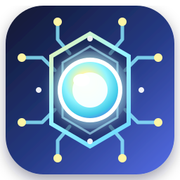
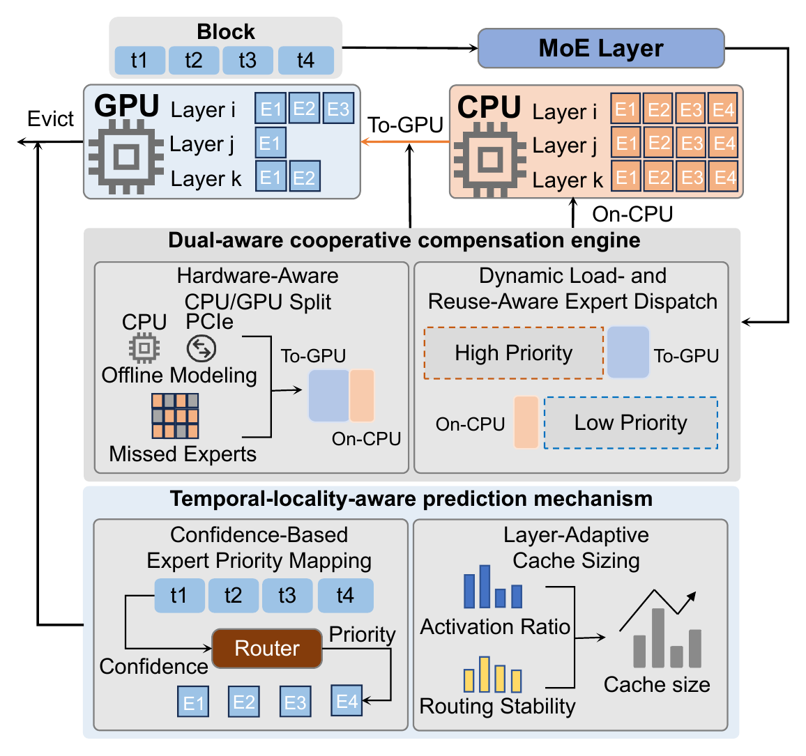

<div align="center">

<h1 align="center"> OLED-MoE</h1>

### Inter-iteration locality-aware expert offloading for MoE diffusion language models

[Overview](#overview) · [Installation](#installation) · [Local chat](#local-chat) · [HTTP server](#http-server) · [Development](#development)

[](https://www.python.org/)
[](https://pytorch.org/)
[](https://developer.nvidia.com/cuda-toolkit)

</div>

## Overview

OLED-MoE addresses a fundamental mismatch between existing expert-offloading
systems and Mixture-of-Experts diffusion language models (MoE-based dLLMs).
Techniques designed for autoregressive decoding rely on intra-iteration
prefetching, but block-wise denoising activates a much larger expert working set.
The resulting transfers are difficult to finish in time, and delayed or
mispredicted prefetches fall onto the decoding critical path.

The key insight is to shift the optimization target from **intra-iteration
prefetching** to **inter-iteration expert retention**. Adjacent denoising
iterations exhibit strong routing overlap, while token confidence provides a
lightweight signal of route stability. OLED-MoE turns this locality into three
complementary mechanisms:

- **Confidence-guided expert retention** maps token confidence and gate scores
  to expert-level reuse priorities, preserving experts with the greatest
  near-future value without generating extra prefetch traffic.
- **Layer-adaptive cache allocation** assigns GPU capacity according to each
  layer's activation and reuse behavior instead of applying a uniform budget.
- **Load- and reuse-aware cooperative compensation** jointly considers current
  computation load and predicted future reuse when deciding whether a cache
  miss should be transferred to the GPU or executed on the CPU.

Across diverse dLLM workloads, OLED-MoE reduces decoding latency and improves
expert-cache utilization over existing offloading systems. It enables MoE-based
dLLMs to retain strong inference performance under tight GPU-memory budgets,
making efficient deployment on memory-constrained accelerators practical.

<p align="center">
  <a href="docs/assets/design-overview.pdf">
    
  </a>
</p>

<p align="center"><sub>OLED-MoE architecture. Click the figure to open the vector PDF.</sub></p>

## Installation

### Requirements

The validated environment is Linux with an NVIDIA GPU:

| Component | Validated version |
| --- | --- |
| Container image | `pytorch/pytorch:2.8.0-cuda12.8-cudnn9-devel` |
| Python | 3.10–3.12 |
| PyTorch | 2.8.0+cu128 |
| vLLM | 0.10.2 |
| CUDA runtime | 12.8 |

The host driver must support CUDA 12.8. Model checkpoints are not included.
Download or mount a complete
[LLaDA2.0-mini](https://huggingface.co/inclusionAI/LLaDA2.0-mini) checkpoint.

### 1. Clone the repositories

```bash
git clone https://github.com/xjy1121/OLED-MoE-test.git OLED-MoE
git clone https://github.com/inclusionAI/dInfer.git dInfer
git -C dInfer checkout 1ffeb961cd258bede74fcf5ca8a416ae6d57b18f
```

OLED-MoE integrates with this exact dInfer revision. Keep the two repositories
next to each other, or set `OLED_DINFER_REPO` explicitly.

### 2. Start a CUDA container

```bash
docker run --rm -it \
  --gpus all \
  --ipc=host \
  --shm-size=32g \
  --ulimit memlock=-1 \
  -v "$PWD/OLED-MoE:/workspace/OLED-MoE" \
  -v "$PWD/dInfer:/workspace/dInfer" \
  -v /path/to/models:/workspace/models:ro \
  -w /workspace/OLED-MoE \
  pytorch/pytorch:2.8.0-cuda12.8-cudnn9-devel
```

### 3. Create the Python environment

Run these commands inside the container:

```bash
python -m venv --system-site-packages .venv
source .venv/bin/activate
python -m pip install --upgrade pip wheel
python -m pip install "setuptools>=77.0.3,<80"
python -m pip install vllm==0.10.2
python -m pip install -e /workspace/dInfer

export OLED_DINFER_REPO=/workspace/dInfer
export OLED_DINFER_PATH=/workspace/dInfer/python
./scripts/setup_dev.sh
python -m pip check
python scripts/check_environment.py --require-cuda
```

`setup_dev.sh` verifies the dInfer revision before installing OLED-MoE with its
development and server dependencies. For a source archive without Git metadata,
review the revision yourself and set `OLED_DINFER_SKIP_REVISION_CHECK=1`.

## Local chat

The terminal interface loads the model once, streams every completed diffusion
block, and retains the conversation until `/clear` or `/exit`:

```bash
CUDA_VISIBLE_DEVICES=0 oled-moe chat \
  --model /workspace/models/LLaDA2mini \
  --dinfer-path /workspace/dInfer/python \
  --device cuda:0 \
  --cache-size 40 \
  --block-length 16 \
  --max-tokens 128
```

Use `/help` inside the client to list the interactive commands.

## HTTP server

Start one loopback worker:

```bash
CUDA_VISIBLE_DEVICES=0 oled-moe serve \
  --model /workspace/models/LLaDA2mini \
  --dinfer-path /workspace/dInfer/python \
  --device cuda:0 \
  --served-model-name llada2-mini \
  --host 127.0.0.1 \
  --port 8000 \
  --block-length 16 \
  --default-max-tokens 128
```

Test the streaming endpoint:

```bash
curl -N http://127.0.0.1:8000/v1/chat/completions \
  -H 'Content-Type: application/json' \
  -d '{"model":"llada2-mini","messages":[{"role":"user","content":"Introduce yourself."}],"stream":true,"max_tokens":64,"block_length":16}'
```

Keep the default loopback bind on remote machines and use an SSH tunnel:

```bash
ssh -N -L 8000:127.0.0.1:8000 user@remote-host
```

Do not expose the development server directly to an untrusted network. It does
not implement authentication, quotas, or multi-tenant isolation.

## Benchmark smoke test

```bash
CUDA_VISIBLE_DEVICES=0 oled-moe benchmark \
  --model /workspace/models/LLaDA2mini \
  --device cuda:0 \
  --gen-length 32 \
  --block-length 16 \
  --cache-size 100 \
  --warmup-runs 1 \
  --runs 3
```

Add `--profile --report-dir runs` to write detailed runtime metrics. Profiling
uses extra CUDA events and should remain disabled for throughput measurements.

## Development

The unit suite does not load model checkpoints:

```bash
python -m pytest -q
python -m ruff check src tests scripts
```

Useful CLI checks:

```bash
oled-moe --help
oled-moe chat --help
oled-moe serve --help
```

See [Architecture](docs/architecture.md) for the package boundaries and runtime
data flow.

## Citation

If you use this codebase, or otherwise found our work valuable, please cite:

```bibtex
@article{xiao2027oledmoe,
  title={OLED-MoE: Accelerating MoE-Based dLLM Inference via Inter-Iteration Locality-Aware Expert Offloading},
  author={Jingyuan Xiao, Jiayue Wang, Yitao Hu, Xinning Wang, Shi Chen, Ziqi Gong, Zhengchao Wang, Guotao Yang, Sheng Chen, Keqiu Li},
  booktitle={Proceedings of the 22nd European Conference on Computer Systems (EuroSys ’27)},
  year={2027}
}
```
